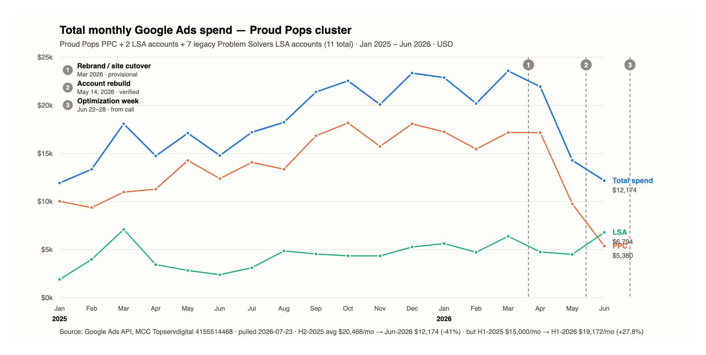

# Proud Pops — Google Ads spend & performance review, Jan 2025 – Jun 2026

**Prepared by:** Eduardo Marinho, Paid Ads
**Date:** July 23, 2026
**Question:** Jonathan's hypothesis from the June 29 relaunch call — that monthly budget was significantly higher last year, when the brand was still Problem Solvers.
**Source for every number in this document:** Google Ads API, pulled 2026-07-23, MCC Topservdigital (4155514468). Account IDs cited per table. Period 2025-01-01 → 2026-06-30 (June 2026 = most recent closed month). Currency USD. **Basis: the 11 Proud Pops / Problem Solvers accounts**; My Favorite Service Company is reported separately in §10.

---

## 1. Executive summary

**Scope note:** this document covers the **11 Proud Pops / Problem Solvers accounts**. My Favorite Service Company's three accounts are reported separately in §10, not blended in.

- **Two things are true at once, and the answer depends on which "last year" you mean.** Against the *same six months* a year ago, spend is **up 27.8%** ($90,002 → $115,033; $15,000 → $19,172 per month). But against the *second half* of last year, the current run rate is **down 41%** ($20,468/mo in Jul–Dec 2025 vs $12,174 in June 2026).

- **On Jonathan's actual point, he is right.** He said the budget "was so much higher" — and if he is picturing autumn 2025, it was. Spend ramped all through 2025 ($11,929 in January to $23,357 in December), peaked at **$23,576 in March 2026**, and has since fallen to **$12,174 in June 2026 — a 48% drop from peak**. What is *not* true is that this was a Problem-Solvers-era budget that got cut. The decline is recent and starts at the **May 14, 2026 account rebuild**.

- **Lead volume from March 2026 onward is understated by the site migration, not by campaign performance.** Website conversion measurement moved with the domain changeover in March 2026, so on-site actions stopped feeding the account from **2026-03-16**. Reported leads read 608 (Mar 2025) → 247 (Mar 2026) → 57 (May 2026). Over the same window the channels Google measures natively — LSA leads and call-extension calls — were **up 165%** year on year. **Use the Google-side series for any comparison spanning March 2026.**

- **The Google deck's central claim is contradicted by the account.** The deck states the account is *not budget limited*. The Proud Pops PPC account lost **23%–59% of Search impression share to budget in 17 of the 18 months reviewed**. It has been budget constrained almost continuously. Detail in §6.

- **Recommendation: $22,000–$24,000/month for the next 90 days**, restoring the Q1-2026 run rate — but **gated on fixing conversion tracking first.** Buying volume the account cannot measure produces spend nobody can defend at the next review. Detail in §9.

---

## 1b. Run rate — the table to bring to the call

This is the framing that reconciles the two answers above. Read it top to bottom and the story is: ramp up through 2025, peak in Q1 2026, sharp fall in Q2 2026.

| Window | Total | Avg / month |
|---|---:|---:|
| H1 2025 (Jan–Jun) | $90,002 | $15,000 |
| **H2 2025 (Jul–Dec)** | **$122,807** | **$20,468** |
| FY 2025 | $212,809 | $17,734 |
| **Q1 2026 (Jan–Mar)** | **$66,644** | **$22,215** |
| Q2 2026 (Apr–Jun) | $48,389 | $16,130 |
| 2026 YTD (Jan–Jun) | $115,033 | $19,172 |
| *June 2026 alone* | *$12,174* | *$12,174* |

**A date-range warning for the call:** if anyone pulls "2025" in the Google Ads UI with an end date of Jan 1, 2026, the picker includes that day and the PPC account shows **$188,706.61**. On calendar months (closing Dec 31) the same account is **$187,625.23**. The $1,081.37 gap is January 1, 2026 alone. Both are correct; they are different windows.

---

## 2. Accounts in scope

Every account under MCC Topservdigital matching the three brands:

| # | Account | ID | Channel | Status | Spend in period |
|---|---|---|---|---|---:|
| 1 | Proud Pops Plumbing, Air & Electric - PPC | 1051843378 | PPC + LSA* | Active | $287,873 |
| 2 | Proud Pops Plumbing, Air & Electric - LSA San Antonio [1] | 7261668241 | LSA | Active | $17,469 |
| 3 | Proud Pops Plumbing, Air & Electric - LSA San Antonio [2] | 6621969129 | LSA + 1 Search campaign | Active | $15,643 |
| 4 | [Old Account] The Problem Solvers - LSA HVAC San Antonio 2 | 8497583415 | LSA | Legacy, dark since Apr 2025 | $587 |
| 5 | [Old Account] The Problem Solvers - LSA HVAC San Antonio 4 | 5229329621 | LSA | Legacy, dark since Apr 2025 | $495 |
| 6 | [Old Account] The Problem Solvers - LSA Plumbing San Antonio 2 | 3490305409 | LSA | Legacy, dark since Apr 2025 | $475 |
| 7 | [Old Account] The Problem Solvers - LSA Plumbing San Antonio 3 | 5504504691 | LSA | Legacy, no spend in period | $0 |
| 8 | [Old Account] The Problem Solvers - LSA Roofing San Antonio | 3477779749 | LSA | Legacy, dark since Mar 2025 | $2,711 |
| 9 | [Old Account] The Problem Solvers - LSA Roofing San Antonio 2 | 5037427931 | LSA | Legacy, no spend in period | $0 |
| 10 | [Old Account] The Problem Solvers - LSA Roofing San Antonio 3 | 4931459362 | LSA | Legacy, dark since Mar 2025 | $2,588 |
| 11 | [Old Account] The Problem Solvers (no LSA connected) | 9776908250 | Unknown | CANCELED — not readable via API | **$0** (UI check) |
| | **Total, 11 accounts** | | | | **$327,842** |

\* The Proud Pops PPC account also contains its own Local Services campaign (`LocalServicesCampaign:SystemGenerated:0005faae70a9d449`, $41,980 in the period). **LSA is not cleanly separated from PPC in this account** — relevant to the Google deck's linkage claim in §6.

**Resolved: the canceled account holds no spend.** Account 9776908250 cannot be read via the API (`CUSTOMER_NOT_ENABLED`). Eduardo checked it directly in the Google Ads UI: **it spent $0 between 2025-01-01 and 2026-01-01.** It was a shell. Nothing is hidden there, and the comparison below is complete.

**Verified: the PPC account was renamed, not replaced.** Account 1051843378 has unbroken monthly spend from January 2025 through June 2026 and still contains conversion actions named `www.txproblemsolvers.com (web) …`. Problem Solvers PPC history and Proud Pops PPC history are the same account. There is no separate 2025 PPC account whose budget was later cut.

### Checked and excluded

| Account | ID | Why excluded |
|---|---|---|
| (unnamed LSA) | 8655979348 | Geo targets resolve to **Albertson / Great Neck / Cold Spring Harbor, New York**. Not San Antonio, not this client. |
| (unnamed LSA) | 2974002658 | Geo targets resolve to **Boone & Kenton County KY / Hamilton County OH**. Not this client. |

---

## 3. Consolidated monthly table

All 11 Proud Pops / Problem Solvers accounts combined. "Leads (as reported)" is what the accounts actually counted — **it is not a consistent metric across the period**; see §8. "Google-side leads" counts only LSA leads, call-extension calls and Google Business Profile calls — sources that do not depend on the website container, and therefore survive the March 2026 tracking break. It is the only lead series comparable end to end.

| Month | PPC spend | LSA spend | Total spend | PPC impr. | PPC clicks | Leads (as reported) | CPL | Google-side leads | Budget-limited? |
|---|---:|---:|---:|---:|---:|---:|---:|---:|---|
| Jan 2025 | $10,026 | $1,903 | **$11,929** | 23,465 | 3,710 | 232 | $51.42 | 52 | **Yes — 36% IS lost** |
| Feb 2025 | $9,372 | $3,986 | **$13,358** | 22,927 | 4,110 | 322 | $41.48 | 88 | **Yes — 45% IS lost** |
| Mar 2025 | $10,982 | $7,101 | **$18,083** | 26,312 | 5,352 | 608 | $29.74 | 106 | **Yes — 59% IS lost** |
| Apr 2025 | $11,289 | $3,447 | **$14,736** | 28,458 | 4,352 | 209 | $70.51 | 78 | **Yes — 43% IS lost** |
| May 2025 | $14,271 | $2,838 | **$17,109** | 41,695 | 6,520 | 188 | $90.90 | 63 | **Yes — 35% IS lost** |
| Jun 2025 | $12,387 | $2,400 | **$14,787** | 39,209 | 4,383 | 319 | $46.35 | 55 | **Yes — 37% IS lost** |
| Jul 2025 | $14,076 | $3,124 | **$17,200** | 44,034 | 5,738 | 624 | $27.54 | 66 | **Yes — 25% IS lost** |
| Aug 2025 | $13,364 | $4,871 | **$18,235** | 169,401 | 7,590 | 1,428 | $12.77 | 136 | **Yes — 26% IS lost** |
| Sep 2025 | $16,833 | $4,551 | **$21,384** | 309,940 | 5,879 | 420 | $50.92 | 225 | **Yes — 29% IS lost** |
| Oct 2025 | $18,182 | $4,364 | **$22,546** | 492,524 | 6,563 | 486 | $46.39 | 245 | **Yes — 34% IS lost** |
| Nov 2025 | $15,734 | $4,351 | **$20,085** | 574,445 | 9,877 | 362 | $55.48 | 201 | **Yes — 27% IS lost** |
| Dec 2025 | $18,075 | $5,282 | **$23,357** | 895,665 | 15,058 | 418 | $55.88 | 286 | **Yes — 37% IS lost** |
| Jan 2026 | $17,243 | $5,637 | **$22,880** | 1,286,796 | 22,383 | 457 | $50.07 | 359 | **Yes — 36% IS lost** |
| Feb 2026 | $15,457 | $4,731 | **$20,189** | 688,761 | 12,835 | 369 | $54.71 | 245 | **Yes — 33% IS lost** |
| Mar 2026 | $17,177 | $6,398 | **$23,576** | 127,181 | 3,176 | 247 | $95.45 | 216 | **Yes — 35% IS lost** |
| Apr 2026 | $17,167 | $4,766 | **$21,933** | 47,651 | 1,851 | 187 | $117.29 | 187 | **Yes — 35% IS lost** |
| May 2026 | $9,764 | $4,517 | **$14,282** | 90,883 | 2,720 | 57 | $250.56 | 57 | **Yes — 23% IS lost** |
| Jun 2026 | $5,380 | $6,794 | **$12,174** | 36,567 | 1,565 | 81 | $150.30 | 109 | No (6%) |
| **FY 2025 total** | $164,592 | $48,217 | **$212,809** | 2,668,075 | 79,132 | 5,617 | $37.89 | 1,601 | — |
| **H1 2025 total** | $68,327 | $21,674 | **$90,002** | 182,066 | 28,427 | 1,878 | $47.92 | 442 | — |
| **H1 2026 total (YTD)** | $82,189 | $32,844 | **$115,033** | 2,277,839 | 44,530 | 1,398 | $82.28 | 1,173 | — |
| **FY 2025 monthly avg** | $13,716 | $4,018 | **$17,734** | 222,340 | 6,594 | 468 | $37.89 | 133 | — |
| **H1 2025 monthly avg** | $11,388 | $3,612 | **$15,000** | 30,344 | 4,738 | 313 | $47.92 | 74 | — |
| **H1 2026 monthly avg** | $13,698 | $5,474 | **$19,172** | 379,640 | 7,422 | 233 | $82.28 | 196 | — |

---

## 4. Year-over-year, same month 2025 vs 2026

| Month | Spend 2025 | Spend 2026 | Δ $ | Δ % | Leads 2025 | Leads 2026 | Δ % | CPL 2025 | CPL 2026 | Google-side leads 2025 → 2026 |
|---|---:|---:|---:|---:|---:|---:|---:|---:|---:|---|
| Jan | $11,929 | $22,880 | +10,951 | +91.8% | 232 | 457 | +97.0% | $51.42 | $50.07 | 52 → 359 (+590%) |
| Feb | $13,358 | $20,189 | +6,831 | +51.1% | 322 | 369 | +14.6% | $41.48 | $54.71 | 88 → 245 (+178%) |
| Mar | $18,083 | $23,576 | +5,493 | +30.4% | 608 | 247 | -59.4% | $29.74 | $95.45 | 106 → 216 (+104%) |
| Apr | $14,736 | $21,933 | +7,197 | +48.8% | 209 | 187 | -10.5% | $70.51 | $117.29 | 78 → 187 (+140%) |
| May | $17,109 | $14,282 | -2,827 | -16.5% | 188 | 57 | -69.7% | $90.90 | $250.56 | 63 → 57 (-10%) |
| Jun | $14,787 | $12,174 | -2,613 | -17.7% | 319 | 81 | -74.6% | $46.35 | $150.30 | 55 → 109 (+98%) |
| **H1 total** | **$90,002** | **$115,033** | **+25,031** | **+27.8%** | **1,878** | **1,398** | **-25.6%** | **$47.92** | **$82.28** | **442 → 1,173 (+165%)** |

**Reading this table:** spend is up in four of six months. **The lead and CPL columns are not comparable from March 2026 onward** — website measurement moved with the domain changeover, so 2026 lead counts are understated and the CPL figures ($95.45 / $117.29 / $250.56 / $150.30) reflect that change rather than campaign performance. The Google-side column is the like-for-like one: up in five of six months, **+165% across H1**.

---

## 5. Per account, per month

Spend, impressions, clicks, leads and CPL per account per channel, as the brief specified. Impressions and clicks are shown for PPC only (Google does not report them meaningfully for Local Services). **CPL here is cost per *reported* conversion** — from March 2026 onward that denominator is understated by the site migration; see §8.

**Proud Pops Plumbing, Air & Electric - PPC** — ID 1051843378

| Month | Spend | Impressions | Clicks | Leads | CPL |
|---|---:|---:|---:|---:|---:|
| Jan 2025 | $10,026 | 23,465 | 3,710 | 203 | $49.39 |
| Feb 2025 | $9,372 | 22,927 | 4,110 | 266 | $35.23 |
| Mar 2025 | $10,982 | 26,312 | 5,352 | 528 | $20.80 |
| Apr 2025 | $11,289 | 28,458 | 4,352 | 157 | $71.91 |
| May 2025 | $14,271 | 41,695 | 6,520 | 149 | $95.64 |
| Jun 2025 | $12,387 | 39,209 | 4,383 | 285 | $43.46 |
| Jul 2025 | $14,076 | 44,034 | 5,738 | 578 | $24.37 |
| Aug 2025 | $13,364 | 169,401 | 7,590 | 1,357 | $9.85 |
| Sep 2025 | $16,833 | 309,940 | 5,879 | 357 | $47.15 |
| Oct 2025 | $18,182 | 492,524 | 6,563 | 425 | $42.78 |
| Nov 2025 | $15,734 | 574,445 | 9,877 | 303 | $51.93 |
| Dec 2025 | $18,075 | 895,665 | 15,058 | 347 | $52.09 |
| Jan 2026 | $17,243 | 1,286,796 | 22,383 | 386 | $44.67 |
| Feb 2026 | $15,457 | 688,761 | 12,835 | 307 | $50.35 |
| Mar 2026 | $17,177 | 127,181 | 3,176 | 160 | $107.36 |
| Apr 2026 | $17,167 | 47,651 | 1,851 | 128 | $134.12 |
| May 2026 | $9,486 | 90,665 | 2,682 | 5 | $1,897.24 |
| Jun 2026 | $4,771 | 36,189 | 1,488 | 1 | $4,770.58 |
| **Total** | **$245,893** | **4,945,318** | **123,547** | **5,942** | **$41.38** |

**Proud Pops PPC — in-account LSA campaign** — ID 1051843378 (Local Services campaign only)

| Month | Spend | Leads | CPL |
|---|---:|---:|---:|
| Jan 2025 | $770 | 14 | $55.01 |
| Feb 2025 | $1,752 | 25 | $70.10 |
| Mar 2025 | $1,145 | 19 | $60.25 |
| Apr 2025 | $1,706 | 23 | $74.15 |
| May 2025 | $1,341 | 16 | $83.81 |
| Jun 2025 | $1,664 | 20 | $83.17 |
| Jul 2025 | $2,104 | 26 | $80.92 |
| Aug 2025 | $2,863 | 37 | $77.34 |
| Sep 2025 | $2,288 | 27 | $84.75 |
| Oct 2025 | $2,585 | 32 | $80.80 |
| Nov 2025 | $2,381 | 26 | $91.59 |
| Dec 2025 | $2,434 | 24 | $101.41 |
| Jan 2026 | $4,022 | 44 | $91.41 |
| Feb 2026 | $2,691 | 27 | $99.67 |
| Mar 2026 | $3,393 | 41 | $82.76 |
| Apr 2026 | $2,587 | 27 | $95.80 |
| May 2026 | $2,665 | 28 | $95.18 |
| Jun 2026 | $3,588 | 37 | $96.98 |
| **Total** | **$41,980** | **493** | **$85.15** |

**Proud Pops - LSA San Antonio [1]** — ID 7261668241

| Month | Spend | Leads | CPL |
|---|---:|---:|---:|
| Feb 2025 | $471 | 10 | $47.10 |
| Mar 2025 | $701 | 14 | $50.06 |
| Apr 2025 | $316 | 8 | $39.56 |
| May 2025 | $672 | 13 | $51.69 |
| Jun 2025 | $737 | 14 | $52.61 |
| Jul 2025 | $800 | 19 | $42.08 |
| Aug 2025 | $897 | 22 | $40.77 |
| Sep 2025 | $1,122 | 25 | $44.89 |
| Oct 2025 | $1,191 | 23 | $51.77 |
| Nov 2025 | $1,330 | 26 | $51.16 |
| Dec 2025 | $1,815 | 36 | $50.41 |
| Jan 2026 | $901 | 20 | $45.04 |
| Feb 2026 | $1,135 | 25 | $45.41 |
| Mar 2026 | $1,666 | 32 | $52.06 |
| Apr 2026 | $1,350 | 21 | $64.30 |
| May 2026 | $939 | 16 | $58.71 |
| Jun 2026 | $1,426 | 24 | $59.43 |
| **Total** | **$17,469** | **348** | **$50.20** |

**Proud Pops - LSA San Antonio [2]** — ID 6621969129

| Month | Spend | Impressions | Clicks | Leads | CPL |
|---|---:|---:|---:|---:|---:|
| Jan 2025 | $670 | 1,452 | 206 | 11 | $60.87 |
| Feb 2025 | $550 | 1,405 | 166 | 8 | $68.79 |
| Mar 2025 | $600 | 1,458 | 115 | 8 | $75.02 |
| Apr 2025 | $898 | 1,536 | 161 | 14 | $64.17 |
| May 2025 | $825 | 1,293 | 121 | 10 | $82.48 |
| Jul 2025 | $220 | 231 | 31 | 2 | $110.11 |
| Aug 2025 | $1,111 | 1,723 | 145 | 12 | $92.57 |
| Sep 2025 | $1,141 | 1,919 | 184 | 11 | $103.69 |
| Oct 2025 | $587 | 1,341 | 148 | 6 | $97.92 |
| Nov 2025 | $639 | 1,014 | 92 | 7 | $91.34 |
| Dec 2025 | $1,033 | 1,052 | 82 | 11 | $93.94 |
| Jan 2026 | $714 | 1,684 | 128 | 7 | $102.04 |
| Feb 2026 | $905 | 962 | 103 | 10 | $90.48 |
| Mar 2026 | $1,339 | 2,136 | 201 | 14 | $95.65 |
| Apr 2026 | $829 | 1,602 | 144 | 11 | $75.39 |
| May 2026 | $1,191 | 1,798 | 148 | 8 | $148.89 |
| Jun 2026 | $2,389 | 3,241 | 268 | 19 | $125.73 |
| **Total** | **$15,643** | **25,847** | **2,443** | **169** | **$92.56** |

**Legacy Problem Solvers LSA — 7 accounts combined** (8497583415, 5229329621, 3490305409, 5504504691, 3477779749, 5037427931, 4931459362)

| Month | Spend | Leads | CPL |
|---|---:|---:|---:|
| Jan 2025 | $463 | 4 | $115.82 |
| Feb 2025 | $1,212 | 13 | $93.22 |
| Mar 2025 | $4,655 | 39 | $119.37 |
| Apr 2025 | $527 | 7 | $75.22 |
| **Total** | **$6,857** | **63** | **$108.84** |

---

## 6. Impression share and budget limitation — Proud Pops PPC (1051843378)

Search campaigns only, cost-weighted across campaigns. This is the direct test of the Google deck's "not budget limited" claim. Google does not report impression share for Local Services campaigns, so LSA cannot be assessed this way — these columns are PPC-only, as the brief specified.

| Month | Search spend | Search impr. share | IS lost to **budget** | IS lost to rank | Budget-limited? |
|---|---:|---:|---:|---:|---|
| Jan 2025 | $10,026 | 18.1% | **35.7%** | 46.2% | **Yes** |
| Feb 2025 | $9,372 | 14.7% | **44.7%** | 40.6% | **Yes** |
| Mar 2025 | $10,982 | 11.8% | **58.7%** | 29.5% | **Yes** |
| Apr 2025 | $11,289 | 17.1% | **42.8%** | 40.1% | **Yes** |
| May 2025 | $14,271 | 17.0% | **34.8%** | 48.2% | **Yes** |
| Jun 2025 | $12,387 | 17.6% | **37.0%** | 45.4% | **Yes** |
| Jul 2025 | $14,076 | 21.3% | **25.2%** | 53.4% | **Yes** |
| Aug 2025 | $8,476 | 21.2% | **26.5%** | 52.3% | **Yes** |
| Sep 2025 | $5,871 | 43.4% | **29.2%** | 27.4% | **Yes** |
| Oct 2025 | $6,693 | 48.8% | **33.6%** | 17.6% | **Yes** |
| Nov 2025 | $5,866 | 47.7% | **26.6%** | 25.7% | **Yes** |
| Dec 2025 | $6,649 | 47.4% | **36.6%** | 16.0% | **Yes** |
| Jan 2026 | $6,306 | 43.2% | **35.9%** | 20.9% | **Yes** |
| Feb 2026 | $5,622 | 37.0% | **33.3%** | 29.6% | **Yes** |
| Mar 2026 | $6,239 | 31.4% | **34.6%** | 34.0% | **Yes** |
| Apr 2026 | $6,208 | 33.2% | **34.8%** | 32.1% | **Yes** |
| May 2026 | $5,315 | 25.3% | **23.0%** | 51.7% | **Yes** |
| Jun 2026 | $2,085 | 17.2% | **6.1%** | 76.7% | No |

**Contradiction with the Google deck, stated plainly.** The deck claims the account is not budget limited. The account's own impression-share data says it lost between 23% and 59% of available Search impressions to budget in every month from January 2025 through May 2026. June 2026 is the sole exception (6.1%) — and only because the rebuilt campaigns are so new that they are losing 76.7% to **Ad Rank** instead, which is a quality/bidding problem, not a budget one.

**The other two deck claims, assessed:**

| Deck claim | Status against account data |
|---|---|
| "Optimization score 86" | **Unverified.** Optimization score is a live, point-in-time value and is not retrievable historically. It also moves with how many Google recommendations you dismiss, which makes it a poor performance measure regardless. |
| "Not budget limited" | **Contradicted.** See table above. |
| "LSA drives ~66% of conversions" | **Unverified as stated, and not reproducible for the account as a whole.** For June 2026, LSA leads were 86 of 91 reported leads (95%) — but only because PPC website measurement was mid-changeover that month. For March 2026, LSA was 93 of 897 (10%). The figure is entirely dependent on which month and which account the rep picked. |
| "LSA accounts not linked to PPC accounts" | **Factually true for the two standalone Proud Pops LSA accounts** (7261668241, 6621969129) — they are separate customer IDs from the PPC account. Worth noting the deck omits that the PPC account 1051843378 *does* contain its own LSA campaign. Recording the status as requested; I agree with Justin that it carries no performance consequence — LSA needs to be linked to the Google Business Profile, not to a PPC account. |

---

## 7. Total monthly spend, with event markers

Marker provenance:

| # | Marker | Date used | Confidence |
|---|---|---|---|
| 1 | Rebrand / site cutover | ~Mar 20, 2026 | **Provisional — inferred, needs confirmation.** Derived from the last date each `txproblemsolvers.com` conversion tag fired (Mar 16–27, 2026). I do not have the actual rebrand announcement date. |
| 2 | Account rebuild | May 14, 2026 | **Verified from account data.** Legacy campaigns last spent May 12–14; the first `TSD_05.14_*` campaigns began spending May 14. |
| 3 | Optimization week | Jun 22–28, 2026 | **From the transcript only.** Justin said "as of like last week" on the June 29 call. Not independently verifiable in the API — change history is capped at 30 days and that window has now closed. |

**The merger with My Favorite Service Company is not marked** — I could not date it from the account data. MFSC's PPC account first shows managed spend in July 2025, which may or may not be the merger. MFSC is reported separately in §10.

---

## 8. What the data does NOT answer

1. **Pre-2025 spend.** The comparison starts January 2025 because that is the window requested. Nothing here speaks to 2024 or earlier — which matters, because the seven legacy Problem Solvers LSA accounts were already winding down by April 2025, so whatever era Jonathan may be remembering before that is outside this data.

2. **What a lead actually costs.** Two separate problems compound here:
   - **The goal set changed over the period.** Actions counted as conversions during 2025 included `Local actions - Directions`, `Local actions - Website visits`, `Store visits` and `Purchase (GA event Shop)` — in January 2026, 230 of 430 counted conversions were map-direction clicks. The current goal set is clean (six lead-type goals), but it means **2025 lead counts sit on a broader definition than 2026 ones**. In the MFSC account a raw `page_view` is still counted, producing 2,738 "conversions" in January 2026 alone.
   - **Website measurement moved with the domain changeover** in March 2026 and was re-instrumented on the Proud Pops domain.
   
   Together these mean **the 2025 CPL and the 2026 CPL are not the same metric** and should not be presented to the client side by side without this caveat.

3. **Whether the new TSD campaigns are working.** Every campaign launched May 14, 2026 shows **zero conversions** — `TSD_05.20_Leads_Search_Nonbranded_Electrical` ($2,616), `TSD_05.14_Leads_Pmax_HVAC` ($2,259), `TSD_05.14_Leads_Search_Nonbranded_Plumbing` ($1,214), `TSD_05.20_PMax_Electrical` ($974). About **$7,100 has run through campaigns that cannot record a conversion.** In-platform conversions for these campaigns sit inside the window where website measurement was changing over, so the reported zero is not by itself evidence about lead delivery. LSA and call volume over the same period were unaffected. This resolves once the re-instrumented measurement has run for a full month.

4. **The effect of the June optimization week.** It falls in the last week of the reporting period, while website measurement was still mid-changeover. There is no clean before/after to measure.

5. **Whether MFSC spend belongs in this comparison at all.** I have included it because of the merger, but if the group thinks of "Proud Pops budget" as excluding MFSC, the H1 numbers change to: H1-2025 $96,588 vs H1-2026 $116,939 (**+21.1%**). The direction of the answer to Jonathan does not change.

6. **Anything about lead quality, close rate, or revenue.** No CRM data is connected.

---

## 9. Recommended monthly budget — next 90 days

**Recommendation: $22,000–$24,000/month total, phased, and gated.**

| Component | Now (Jun 2026) | Recommended | Reasoning |
|---|---:|---:|---|
| PPC | $5,380 | $15,000–$17,000 | Restores roughly the Q1-2026 level ($15,500–$17,200/mo), the last period with both healthy spend and a functioning conversion signal. |
| LSA | $6,794 | $7,000 | Hold. LSA is the steadiest performer and the only channel whose measurement never broke. |
| **Total** | **$12,174** | **$22,000–$24,000** | Back to the Q1-2026 run rate ($22,215/mo), not beyond it. |

**The reasoning, made explicit:**

- **What justifies an increase:** the account is genuinely budget limited. It lost 23–35% of Search impression share to budget in every month of 2026 through May. That is demand the client is paying to be visible for and then not showing up to. This is the strongest argument available and it is on solid ground.

- **What does NOT justify it, and why I am not recommending more than $26k:**
  - June 2026 lost **76.7%** of impression share to **Ad Rank**, not budget. Money does not fix Ad Rank — that is ad relevance, landing page and bid strategy. Adding budget to a rank-constrained account raises CPCs without raising volume. **This is the single strongest reason not to go higher right now.**
  - The rebuilt campaigns have only been live since May 14 and have limited conversion history to bid on. Smart bidding needs a few weeks of clean signal before extra budget converts into extra volume.

- **Hard gate before any increase is executed.** Two things must be true first:
  1. Website conversion measurement confirmed live on the Proud Pops domain and verified receiving hits end to end.
  2. Goal set confirmed to the six lead-type goals, with engagement actions (`page_view`, `Store visits`, `Local actions - Directions`) kept non-biddable so CPL stays a true cost per lead.

  Suggested sequencing: **weeks 1–2** fix tracking and goals at current spend; **weeks 3–6** step PPC to ~$12k/mo and confirm the signal is real; **weeks 7–12** step to $15–17k/mo if CPL holds.

- **Per TSD policy, a budget change requires written client approval via an AM ticket.** This document is the supporting analysis for that request, not an authorization to execute.

---

## 10. My Favorite Service Company — reported separately

Jacob's company, merged with Proud Pops. Not on the 11-account list and **not blended into any table above.** Its first managed spend appears July 2025.

| Account | ID | Spend in period |
|---|---|---:|
| My Favorite Service Company (PPC) | 9815330464 | $27,152 |
| MFSC - LSA New Braunfels | 4127524472 | $14,826 |
| MFSC - LSA San Antonio | 4905286019 | $2,953 |

H1-2025 $11,158 → H1-2026 $16,424. Blended with the 11, the headline H1 comparison becomes $101,160 → $131,457 (**+29.9%**) instead of **+27.8%**.

**MFSC PPC — Search impression share** (account 9815330464, Search campaigns only, cost-weighted):

| Month | Search spend | Search impr. share | IS lost to **budget** | IS lost to rank | Budget-limited? |
|---|---:|---:|---:|---:|---|
| Jul 2025 | $1,493 | 30.9% | **5.1%** | 64.0% | No |
| Aug 2025 | $1,675 | 46.1% | **0.0%** | 53.9% | No |
| Sep 2025 | $1,277 | 44.5% | **0.0%** | 55.5% | No |
| Oct 2025 | $750 | 43.9% | **0.0%** | 56.1% | No |
| Nov 2025 | $124 | 18.8% | **0.0%** | 81.2% | No |
| Dec 2025 | $46 | 26.3% | **0.0%** | 73.7% | No |
| Jan 2026 | $214 | 29.6% | **0.0%** | 70.4% | No |
| Feb 2026 | $572 | 31.3% | **0.0%** | 68.7% | No |
| Mar 2026 | $524 | 28.2% | **0.0%** | 71.8% | No |
| Apr 2026 | $1,009 | 23.2% | **0.0%** | 76.8% | No |
| May 2026 | $1,007 | 27.0% | **0.0%** | 73.0% | No |
| Jun 2026 | $2,853 | 32.7% | **0.2%** | 67.1% | No |

Unlike the Proud Pops account, MFSC is **not** budget limited — it loses 53–81% of impression share to **Ad Rank**, which is a quality and bidding problem. Extra budget here would not buy volume.

**MFSC measurement note:** on-site actions on `myfavoriteservicecompany.com` stopped feeding the account on 2026-03-31, and a raw **`page_view`** is configured as a primary conversion — it alone produced 2,738 "conversions" in January 2026. MFSC lead counts before April 2026 are inflated on that basis.

---

## Appendix — how these numbers were produced

- Google Ads API v24 via the `google-ads-ratos` skill, profile `.env.topserv`, `login_customer_id` 4155514468. Pulled 2026-07-23.
- Account discovery: `customer_client` enumerated across the full MCC (124 accounts), filtered by name to the three brands, then geo-verified for the two unnamed LSA accounts.
- Spend/impressions/clicks/conversions: `FROM campaign`, segmented by `segments.month`, `2025-01-01` → `2026-06-30`, split on `campaign.advertising_channel_type` (`LOCAL_SERVICES` = LSA, everything else = PPC). Costs converted from micros.
- Impression share: `metrics.search_impression_share` and `metrics.search_budget_lost_impression_share`, Search campaigns only, cost-weighted.
- Lead attribution and the March 2026 measurement changeover: `segments.conversion_action_name` × `segments.month` and × `segments.date`, cross-referenced with `conversion_action.status` / `category`.
- Nothing in this document is estimated. Where a number could not be verified it is marked **unverified** and left out of the totals.
